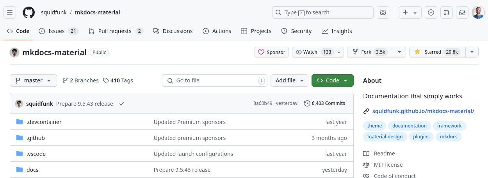
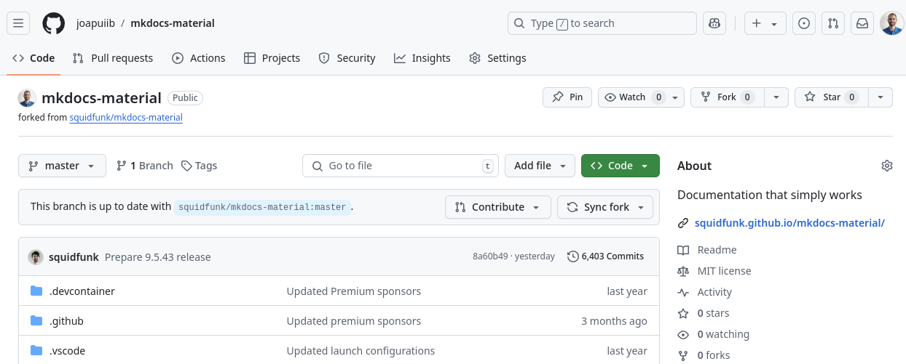
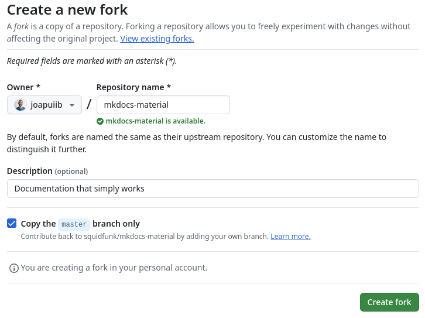
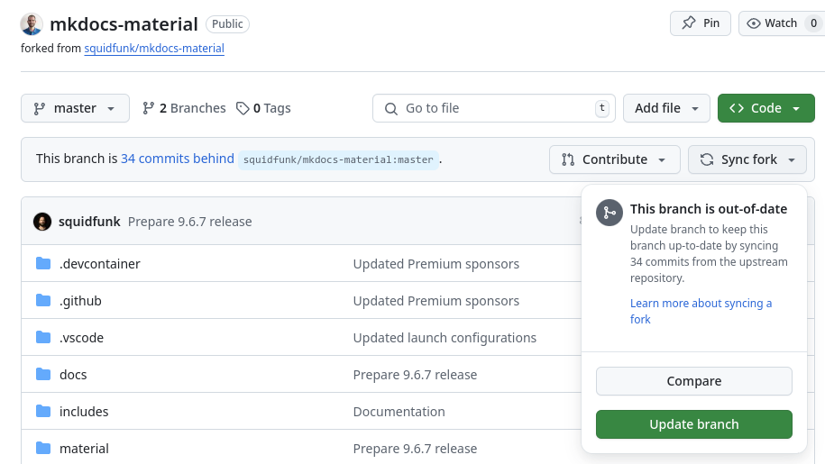

*[PR]: Pull Request

## Forks i Pull Requests
Entre les ferramentes de col·laboració que ofereixen els serveis d'allotjament de repositoris en línia,
com :simple-github: GitHub, :simple-gitlab: GitLab o :simple-codeberg: Codeberg, hi ha dues funcionalitats clau:

- __:material-source-fork: Forks__: permeten copiar com a propi un repositori d'una altra persona
    o organització. En aquesta còpia es poden fer canvis, afegir funcionalitats o corregir errors
    sense afectar el repositori original. El _fork_ queda enllaçat amb el repositori original,
    de manera que es pot mantindre sincronitzat si el repositori original canvia.

- __:material-source-pull: Pull Requests__: permeten sol·licitar la incorporació de canvis d'un repositori
    en un altre. Si una persona ha fet canvis en un _fork_ i vol que s'incorporen al repositori original,
    pot enviar una __pull request__. Les persones propietàries del repositori original la revisaran
    i podran acceptar-la o rebutjar-la.

Aquestes dues funcionalitats són essencials per a col·laborar de manera distribuïda en projectes
de desenvolupament de programari, sobretot en projectes de __:material-open-source-initiative: codi obert__.

## :material-source-fork: Forks
Una [__bifurcació__](https://docs.github.com/es/pull-requests/collaborating-with-pull-requests/working-with-forks/fork-a-repo)
(_fork_) és una còpia d'un repositori que passa a pertànyer a una persona o organització com a propi.
En el teu _fork_ pots fer qualsevol canvi, com ara:

- __Correccions__: corregir errors.
- __Funcionalitats__: afegir funcionalitats noves.
- __Documentació__: millorar la documentació.
- __Adaptacions__: adaptar el codi a les teues necessitats.

Un _fork_ sempre està enllaçat amb el repositori original. Per tant, si el repositori original canvia,
pots decidir incorporar-ne els canvis al teu _fork_.


/// shadow-figure-caption | #figure-fork
    attrs: {class: no-shadow}
Estructura de treball amb _forks_ i _pull requests_.
///


??? example "Exemple: Bifurcació de :simple-materialformkdocs: Material for MkDocs"
    La imatge següent mostra el repositori de [:simple-materialformkdocs: Material for MkDocs][mkdocs-material].

    
    /// shadow-figure-caption | #figure-fork-principal : [Repositori :simple-materialformkdocs: Material for MkDocs][mkdocs-material].

    Per a poder fer-hi contribucions, s'ha creat un [:material-source-fork: __fork__][mkdocs-material-fork]
    del repositori original.

    
    /// shadow-figure-caption | #figure-fork-forked : [Repositori :simple-materialformkdocs: Material for MkDocs bifurcat][mkdocs-material-fork].

[mkdocs-material]: https://github.com/squidfunk/mkdocs-material
[mkdocs-material-fork]: https://github.com/joapuiib/mkdocs-material


### Creació d'un _fork_
Per a crear un _fork_ d'un repositori, cal accedir a la pàgina del repositori i fer clic en el botó
__:material-source-fork: Fork__, que apareix en la part superior dreta.

??? example "Exemple: Creació d'un _fork_ de :simple-materialformkdocs: Material for MkDocs"
    La imatge següent mostra el menú de creació d'un _fork_ del repositori :simple-materialformkdocs: Material for MkDocs.

    
    /// shadow-figure-caption | #figure-fork-create : Creació d'un _fork_ del repositori :simple-materialformkdocs: Material for MkDocs.


### :octicons-sync-24: Sincronització amb el repositori original
Si el repositori original té canvis nous des que es va crear el _fork_, pots incorporar-los al teu _fork_
per a mantindre'l actualitzat amb el botó __:octicons-sync-24: Sync fork__.

??? example "Exemple: Sincronització amb el repositori original"
    El repositori original :simple-materialformkdocs: Material for MkDocs té canvis nous
    (concretament, 34 _commits_ nous), de manera que es pot sincronitzar el _fork_.

    
    /// shadow-figure-caption | #figure-sync : Sincronització d'un _fork_ amb el repositori original :simple-materialformkdocs: Material for MkDocs.

!!! docs "Documentació oficial: [:octicons-link-external-16: Syncing a fork](https://docs.github.com/en/pull-requests/how-tos/work-with-forks/syncing-a-fork) – GitHub"


### Sincronització des del repositori local (`upstream`)
El botó __Sync fork__ actualitza el _fork_ remot, però no el teu repositori local. Una alternativa
és sincronitzar el _fork_ des de la terminal. Per a això, cal afegir un segon remot que apunte
al repositori original. Per convenció, aquest remot s'anomena __`upstream`__, mentre que `origin`
continua apuntant al teu _fork_.

Quan es clona un _fork_, Git només crea el remot `origin`. Per tant, cal afegir `upstream`
amb l'ordre [`git remote add`][git-remote-add]:

```bash
git remote add upstream <url-repositori-original>
```

Es pot comprovar que ara el repositori té dos remots amb l'ordre `git remote -v`.

??? example "Exemple: Afegir el remot `upstream`"
    S'afig el repositori original de :simple-materialformkdocs: Material for MkDocs
    com a remot `upstream` del _fork_ clonat.

    ```shellconsole
    jpuigcerver@fp:~/mkdocs-material (main) $ git remote add upstream https://github.com/squidfunk/mkdocs-material.git
    jpuigcerver@fp:~/mkdocs-material (main) $ git remote -v
    origin    https://github.com/joapuiib/mkdocs-material.git (fetch)
    origin    https://github.com/joapuiib/mkdocs-material.git (push)
    upstream  https://github.com/squidfunk/mkdocs-material.git (fetch)
    upstream  https://github.com/squidfunk/mkdocs-material.git (push)
    ```

    Es pot comprovar que `origin` apunta al _fork_ i `upstream` al repositori original.

Una vegada configurat `upstream`, la sincronització consta de tres passos: descarregar els canvis
del repositori original, incorporar-los a la branca local i publicar-los en el _fork_.

1. Descarrega els canvis del repositori original amb [`git fetch`][git-fetch]:

    ```bash
    git fetch upstream
    ```

2. Canvia a la branca que vols actualitzar (per exemple, `main`) i incorpora-hi els canvis
    de `upstream/main`:

    ```bash
    git switch main
    git merge upstream/main
    ```

3. Publica la branca actualitzada en el teu _fork_:

    ```bash
    git push origin main
    ```

??? example "Exemple: Sincronització del _fork_ amb `upstream`"
    Es descarreguen els canvis nous del repositori original i s'incorporen a la branca `main`.

    ```shellconsole
    jpuigcerver@fp:~/mkdocs-material (main) $ git fetch upstream
    jpuigcerver@fp:~/mkdocs-material (main) $ git switch main
    jpuigcerver@fp:~/mkdocs-material (main) $ git merge upstream/main
    jpuigcerver@fp:~/mkdocs-material (main) $ git push origin main
    ```

    Després d'aquests passos, la branca `main` del _fork_ i la del repositori original
    contenen els mateixos _commits_.

!!! recommend "Evita fer _commits_ sobre la branca principal del _fork_."
    Per evitar problemes de sincronització, és recomanable no fer _commits_ sobre la branca principal
    del _fork_, ja que a l'hora d'integrar nous canvis del repositori original es poden originar
    __conflictes__ i la història no serà __lineal__.

    Per evitar-ho, cal realitzar els canvis en __branques dedicades__ i incorporar-los
    al repositori principal mitjançant _pull requests_.

[git-remote-add]: ../03_remots/remots.md#afegir-un-repositori-remot
[git-fetch]: ../03_remots/remots.md#sincronitzacio-entre-repositoris-git-fetch


### :octicons-git-pull-request-24: Pull Request
Per a contribuir al repositori original, es pot crear una
[__sol·licitud d'incorporació de canvis__ o __:octicons-git-pull-request-24: Pull Request__][pr],
que es presenta en els apunts següents.

[pr]: pull_requests.md
